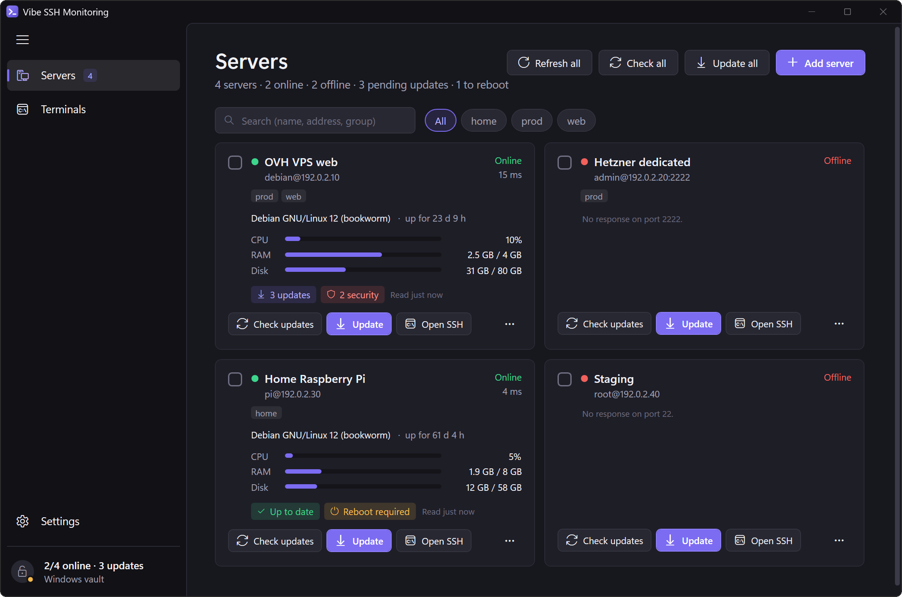
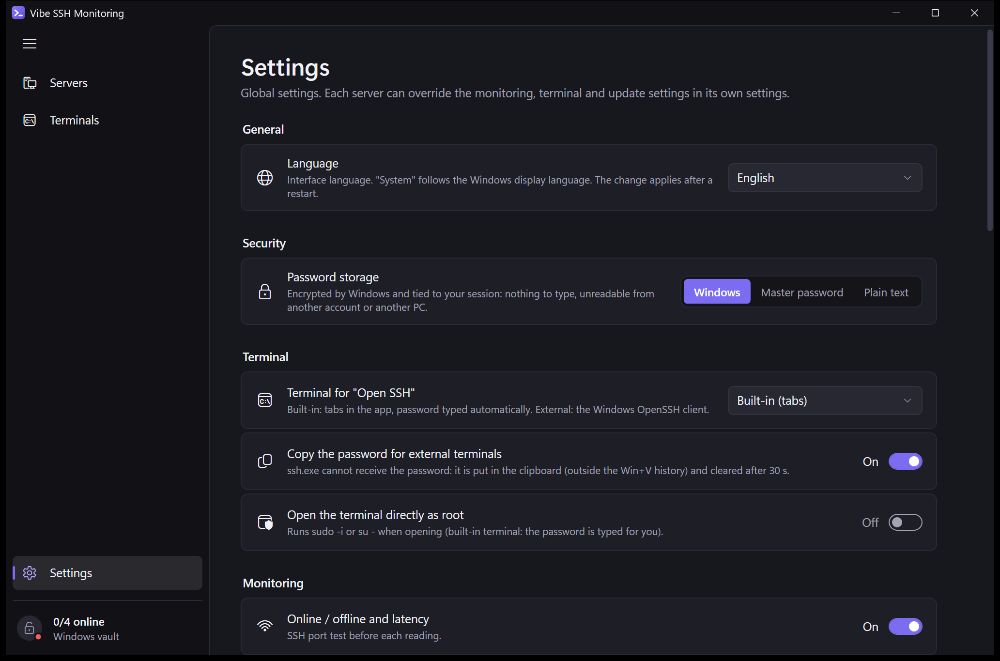
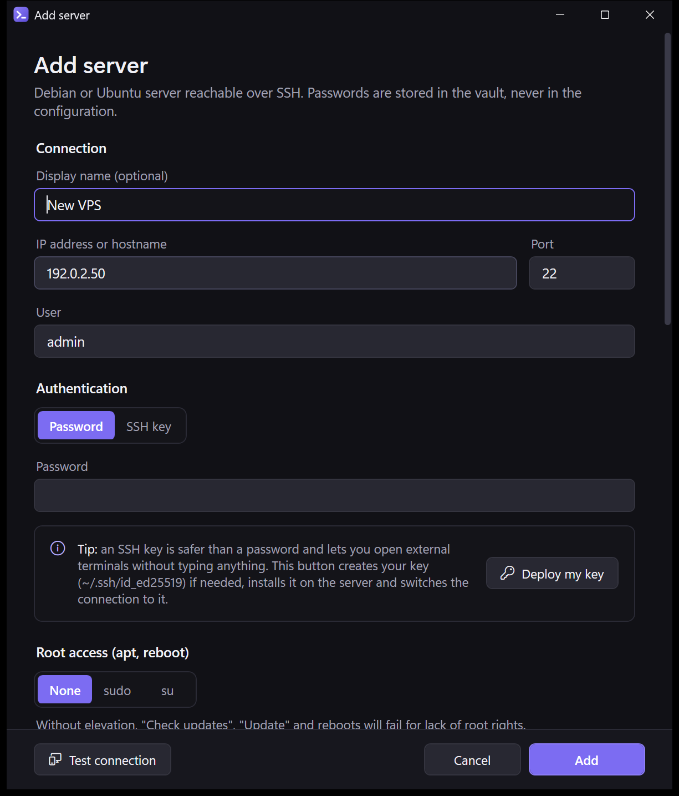

<p align="center">
  
</p>

<h1 align="center">Vibe SSH Monitoring</h1>

<p align="center">
  Monitor and update your Debian / Ubuntu servers (VPS, dedicated, Raspberry Pi…) over SSH, from a native Windows app.
</p>

<p align="center">
  <a href="https://github.com/Baba0bab/VibeSSHMonitoring/actions/workflows/ci.yml"></a>
  <a href="https://github.com/Baba0bab/VibeSSHMonitoring/releases/latest"></a>
  <a href="LICENSE"></a>
  
</p>

<p align="center">
  🇬🇧 English · <a href="README.fr.md">🇫🇷 Français</a>
</p>

> The interface is available in **English, French, German and Spanish**. It follows the Windows display language by default; change it in *Settings → General → Language*.



## Features

- **Server list** with live status, refreshed in the background: online / offline and latency, CPU, RAM, disk, load, distribution, kernel, uptime, number of pending updates (including security updates) and *reboot required*.
- **Check updates**: runs `apt-get update` as root, then shows the `apt list --upgradable` list package by package (current → new version, repository, security badge).
- **Update**: non-interactive `apt-get upgrade` (or `full-upgrade`) with a live log. Locally modified configuration files are kept (`--force-confold`), services are restarted by needrestart, optional `autoremove`.
- **Root access, per server**: direct `root` login, **sudo**, or **su** (log in as a regular user, then switch to root with the root password, for servers that refuse root logins).
- **Open SSH**: built-in terminal (tabs, xterm.js: colors, `htop`, `nano`, copy / paste) or an external one: Windows Terminal, PowerShell, Command Prompt, PuTTY or any custom command. Optional *open as root* (`sudo -i` / `su -`, password typed for you in the built-in terminal).
- **Bulk actions** on a selection of servers (refresh, check updates, update, reboot four servers at a time), **groups / tags** with filters, search, **Reboot** button.
- **System tray**: monitoring keeps running when the window is closed; Windows notifications for new updates, unreachable servers and changed host keys; scheduled update checks (every 6 / 12 / 24 h).
- **Global settings + per-server overrides** for monitoring, terminal and update options.
- **Installer and automatic updates**: per-user installer (no admin rights); the app updates itself from GitHub Releases (small delta downloads, installed when you close the app).
- **Multilingual**: English, French, German and Spanish.

| Settings | Server editor |
|---|---|
|  |  |

## Requirements

| | |
|---|---|
| **Your PC** | Windows 10 or Windows 11, x64. Nothing else to install (the .NET runtime is bundled). The built-in terminal uses the [Microsoft Edge WebView2 Runtime](https://developer.microsoft.com/microsoft-edge/webview2/), included in Windows 11 and in up-to-date Windows 10. |
| **Your servers** | Debian, Ubuntu or a derivative (anything with `apt-get`), reachable over SSH. Password or key authentication. |

## Installation

1. Download **`VibeSSHMonitoring-win-Setup.exe`** from the [latest release](https://github.com/Baba0bab/VibeSSHMonitoring/releases/latest).
2. Run it. The app is installed for your Windows account only, **without administrator rights**, in `%LOCALAPPDATA%\VibeSSHMonitoring`, with a Start menu and a desktop shortcut, then starts.

> **Windows SmartScreen**: the installer is not code-signed, so Windows may show *"Windows protected your PC"*. Click **More info → Run anyway**. Each release publishes `SHA256SUMS.txt` to check the download:
> ```powershell
> Get-FileHash .\VibeSSHMonitoring-win-Setup.exe -Algorithm SHA256
> ```

**Portable version**: `VibeSSHMonitoring-win-Portable.zip`, extract it anywhere (USB drive…) and run `VibeSSHMonitoring.exe`. It can update itself too.

### Updates

The app checks GitHub Releases at startup and then every 12 hours, downloads new versions in the background (usually only a small *delta*) and installs them **when you close the app**, or right away with **Restart and update** (*Settings → Application updates*, or the button that appears in the side menu). You can turn off automatic checks or automatic installation, and opt in to pre-releases, in the same settings section.

### Uninstalling

*Windows Settings → Apps → Installed apps → Vibe SSH Monitoring → Uninstall*. This removes the app, its shortcuts, the *start with Windows* entry and the built-in terminal cache. Your servers and passwords (`%APPDATA%\VibeSSHMonitoring`) are **kept** for a future reinstall: delete that folder to remove them too.

## Getting started

1. **Add server**: address, port, user, then a password or an SSH key.
2. Pick the **root access** method (*None* if you log in as root, *sudo* or *su*).
3. Click **Test connection**: it checks the login, then root access. On the first connection, compare the displayed host key fingerprint with the server's (`ssh-keygen -lf /etc/ssh/ssh_host_ed25519_key.pub`) before approving it.
4. Optional but recommended: **Deploy my key** creates an SSH key (`~/.ssh/id_ed25519`) if needed, installs it on the server and switches the server to key authentication.

### Server-side root access

The app runs its root commands as `sudo -- sh -c '…'` (or through `su`). Choose one of:

- **sudo with a password** (default): store the sudo password in the server settings; it is sent on sudo's standard input, never on a command line.
- **sudo without a password**: leave the sudo password empty and allow passwordless sudo for that user:
  ```
  # /etc/sudoers.d/vibe-ssh-monitoring  (edit with: sudo visudo -f /etc/sudoers.d/vibe-ssh-monitoring)
  youruser ALL=(root) NOPASSWD: ALL
  ```
  A rule limited to `apt-get` does **not** work: the commands go through `sh -c`, and allowing `sh` is equivalent to full root access anyway.
- **su**: store the root password; for servers where `root` cannot log in over SSH.

## Security

| Topic | What the app does |
|---|---|
| Password storage | Your choice: **Windows (DPAPI)** - encrypted and tied to your Windows session, nothing to type (default); **master password** - Argon2id + AES-256-GCM, asked at startup, optional auto-lock; **plain text** - with a warning. Secrets live in `secrets.json`, never in `config.json`. |
| Host keys | The SHA-256 fingerprint is approved on first connection, then **checked on every connection**: if it changes, the connection is refused and an alert is shown. |
| sudo | The password goes through standard input (`sudo -S`), never in a command line; the command itself runs with stdin redirected to `/dev/null`. |
| External terminals | `ssh.exe` cannot receive a password: it is copied to the clipboard (excluded from Win+V history and cloud sync) and cleared after 30 s. With an SSH key there is nothing to type. |
| Network | The app connects to your servers, and to GitHub to check for app updates (can be turned off). The built-in terminal page is local and offline (no CDN). No telemetry. |

Data locations: `%APPDATA%\VibeSSHMonitoring\config.json` (servers, settings), `%APPDATA%\VibeSSHMonitoring\secrets.json` (vault). Found a vulnerability? See [SECURITY.md](SECURITY.md).

## Building from source

Prerequisites: [.NET 10 SDK](https://dotnet.microsoft.com/download/dotnet/10.0) and Windows. Visual Studio 2022 (17.14+), Rider or VS Code are optional.

```powershell
git clone https://github.com/Baba0bab/VibeSSHMonitoring.git
cd VibeSSHMonitoring
dotnet run                          # build and start (Debug), with your real servers
dotnet run --launch-profile Test    # test mode: separate data and a demo server
dotnet test Tests                   # unit tests
```

A copy started with `dotnet run` is not installed: automatic updates are disabled there (the settings page says so).

**Tests** cover the vault (master password, wrong password, mode changes), output parsing (`apt list`, `/proc`), settings resolution, SSH arguments, translations (same keys and placeholders in every language), and the syntax of every shell script sent to servers, checked with Git for Windows' `sh` when it is installed.

`dotnet run` always opens your real configuration, even in a terminal where test variables are still set; quit the installed copy first (notification area icon › Quit), otherwise only its window is shown.

**Test mode**: `dotnet run --launch-profile Test` uses a separate configuration and vault (`%TEMP%\VibeSSHMonitoring.Demo`) and adds a demo server that replays an upgrade in a loop. It runs beside the installed copy. To pick the folder, set `VIBESSHMONITORING_HOME` before this command, or before starting the built exe directly.

### Building the installer

The installer and update packages are built with [Velopack](https://velopack.io) (`vpk`, pinned in [`dotnet-tools.json`](dotnet-tools.json)) by [`scripts/pack.ps1`](scripts/pack.ps1), the same script the release workflow runs:

```powershell
./scripts/pack.ps1 -Version 1.0.1          # → Releases\VibeSSHMonitoring-win-Setup.exe, -Portable.zip, *.nupkg
```

The release notes embedded in the package (and shown in the app) come from the matching `## [x.y.z]` section of [CHANGELOG.md](CHANGELOG.md). If the previous version's packages are in `Releases\`, a delta package is generated too.

To test updates locally without GitHub, point an installed copy at a folder containing newer packages:

```powershell
$env:VIBESSHMONITORING_UPDATE_SOURCE = "C:\path\to\Releases"
& "$env:LOCALAPPDATA\VibeSSHMonitoring\current\VibeSSHMonitoring.exe"
```

### Publishing a release

Releases are built by GitHub Actions ([`.github/workflows/release.yml`](.github/workflows/release.yml)): add a `## [x.y.z] - date` section to [CHANGELOG.md](CHANGELOG.md), commit, then push a version tag. The workflow runs the tests, builds the installer and the full + delta update packages, and publishes them on GitHub Releases, installed copies pick the update up automatically. A tag with a suffix (`v1.1.0-beta.1`) creates a pre-release, offered only to users who opted in to pre-releases.

```powershell
git tag -a v1.0.1 -m "Vibe SSH Monitoring 1.0.1"
git push origin v1.0.1
```

## Project structure

```
├─ Program.cs            entry point (installer / updater hooks, then WPF)
├─ Core/                 SSH, remote commands, vault, configuration, updates (no UI)
│  ├─ Loc.cs            translations (Localization/*.json, English fallback)
│  ├─ SshConnection.cs   connection, host key check, plain / sudo / su execution
│  ├─ RemoteCommands.cs  status probe, apt commands, output parsing
│  ├─ SecretVault.cs     DPAPI, master password (Argon2id + AES-GCM) or plain text
│  ├─ TerminalSession.cs built-in terminal session (automatic root)
│  ├─ ExternalTerminal.cs Windows Terminal, PowerShell, cmd, PuTTY, custom
│  └─ AppUpdater.cs      app updates from GitHub Releases (Velopack)
├─ UI/                   view model, dialogs, tray icon, built-in terminal view
├─ Assets/terminal/      xterm.js page loaded offline by WebView2
├─ Localization/         interface texts: en.json (reference), fr.json, de.json, es.json
├─ Themes/Theme.xaml     colors and control styles
├─ ServerManager.cs      monitoring loop, actions, bulk actions, notifications
├─ AppController.cs      app lifecycle: config, vault, window, tray, auto-lock
├─ MainWindow.xaml       servers, server details, terminals, settings
├─ ServerEditWindow.xaml server editor, connection test, key deployment
├─ scripts/pack.ps1     installer and update packages (Velopack)
└─ Tests/                xUnit tests
```

## Contributing

Bug reports, ideas, translations and pull requests are welcome, see [CONTRIBUTING.md](CONTRIBUTING.md). To add a language, copy `Localization/en.json` to `<code>.json`, translate the values and add the language to `Loc.Languages` in `Core/Loc.cs`. Maintainers: release checklist in [docs/RELEASING.md](docs/RELEASING.md).

## License

Copyright © 2026 Baba0bab. Released under the **GNU General Public License v3.0 or later**, see [LICENSE](LICENSE). You may use, study, modify and redistribute this software; distributed modified versions must remain under the GPL and provide their source code.

Third-party components (SSH.NET, xterm.js, WebView2 SDK, Velopack, Argon2…) are listed in [THIRD-PARTY-NOTICES.md](THIRD-PARTY-NOTICES.md).
